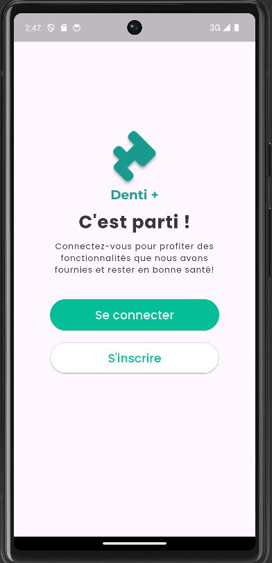
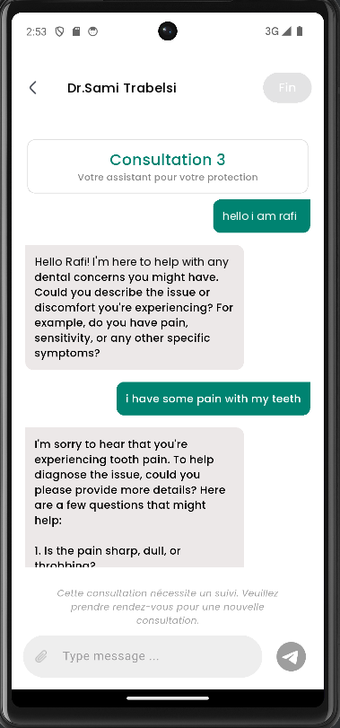
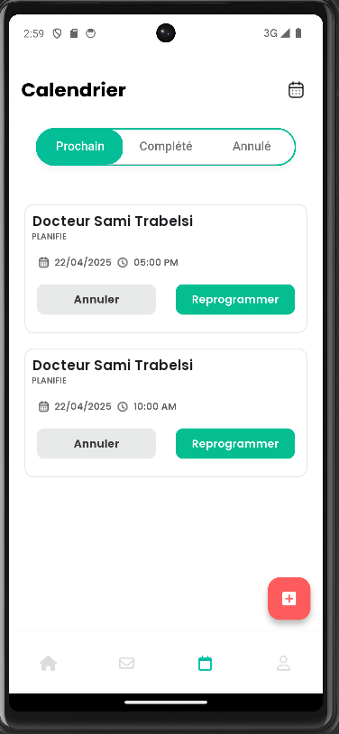
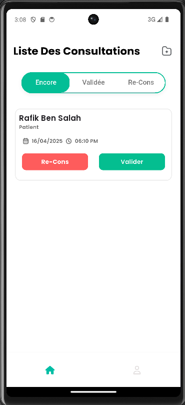
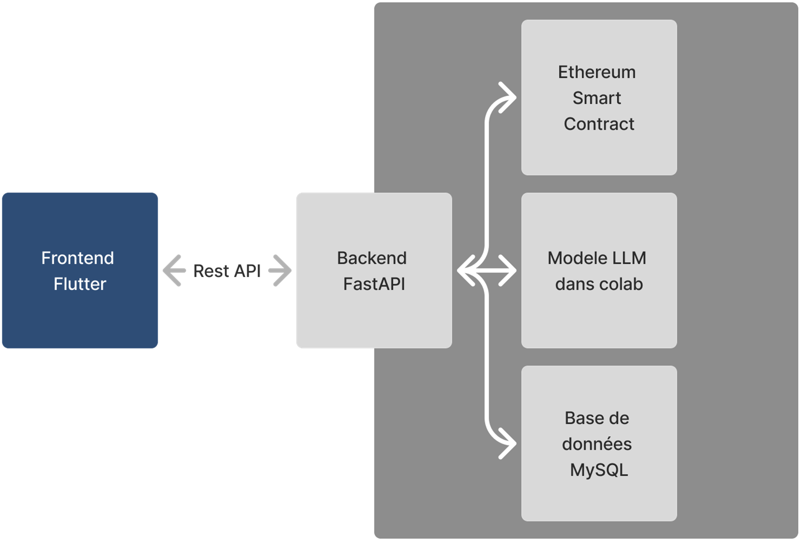
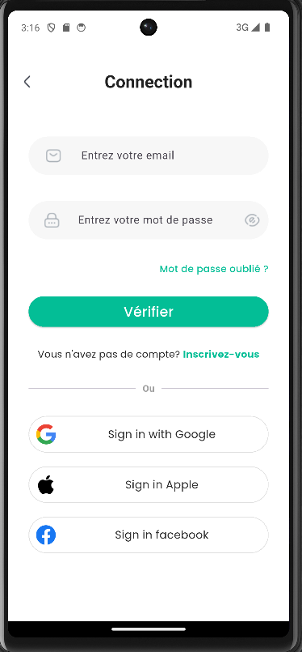
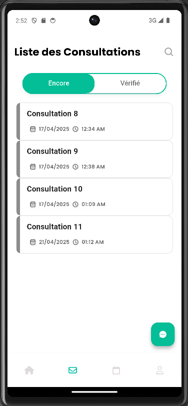
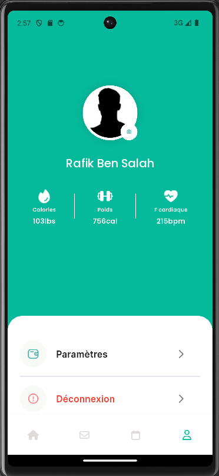
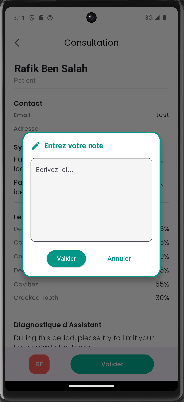
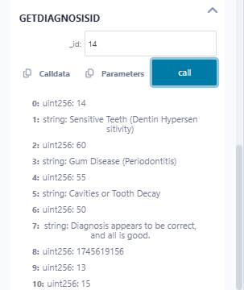

# DentiPlus

A dental consultation platform with an AI assistant. Patients describe their symptoms in a chat with a language model, which suggests likely conditions with a confidence score; a dentist then reviews, corrects or validates the diagnosis. Validated diagnoses are recorded on the Ethereum blockchain, so anyone can check later that they were not altered.

Master's final-year project (PFE), 2025, built in a team of two.

<p align="center">
  
  
  
  
</p>

## Features

**Patients**
- Sign up, log in, change password and profile photo
- Consultation chat with the AI assistant, which asks follow-up questions and suggests the 3 most likely conditions with a confidence score
- Book, reschedule and cancel appointments; follow-up consultations when the dentist asks for one
- Check that a validated diagnosis matches the one recorded on the blockchain

**Dentists**
- Consultations to review, validated, and waiting for a follow-up
- Consultation details: chat summary, the AI's hypotheses and confidence, and a note the AI can help rewrite
- Validate the diagnosis or ask for a follow-up consultation; either way the diagnosis is recorded on the blockchain

## Architecture

<p align="center">
  
</p>

| Part | Stack |
|---|---|
| [Mobile app](frontend/) | Flutter 3.29 (Android, iOS), Provider, Dio |
| [API](backend/) | FastAPI, SQLAlchemy, MySQL, JWT authentication with doctor and patient roles |
| AI service | Qwen2.5-7B-Instruct (4-bit GGUF) with llama.cpp, served by FastAPI from a Google Colab GPU through ngrok |
| Blockchain | Solidity smart contract on the Ethereum Sepolia test network, called with web3.py |

## Repository

```
backend/    FastAPI API, Colab notebooks for the AI service, Solidity contracts
frontend/   Flutter app
docs/       Screenshots
```

## Getting Started

1. **API**: create a MySQL database, copy `backend/.env_template` to `backend/.env`, then:

   ```bash
   cd backend
   pip install -r requirements.txt
   uvicorn main:app --port 5001
   ```

   The interactive API documentation is at http://localhost:5001/docs. See the [backend README](backend/README.md) for every setting.

2. **App**: set the API address in `frontend/lib/services/config.dart`, then:

   ```bash
   cd frontend
   flutter pub get
   flutter run
   ```

3. **Optional services**: the AI chat needs the Colab notebook running, and validating diagnoses needs a deployed contract. Both are explained in the [backend README](backend/README.md#ai-service). Without them, the rest of the app works.

## More Screenshots

<p align="center">
  
  
  
  
</p>

<p align="center">
  <br>
  <em>A diagnosis read back from the smart contract: the 3 conditions with their confidence, the dentist's diagnosis, the date and the patient and dentist IDs</em>
</p>
